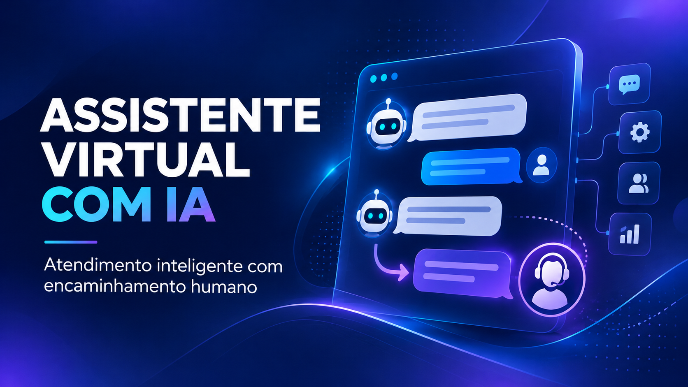
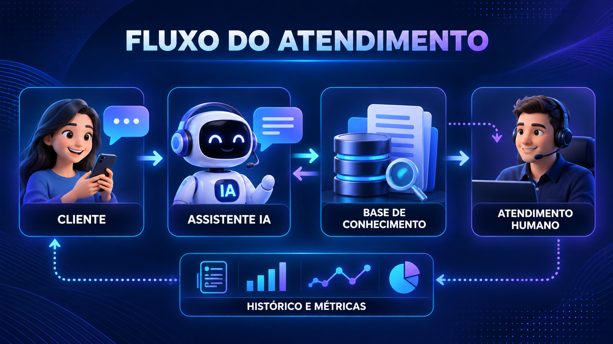
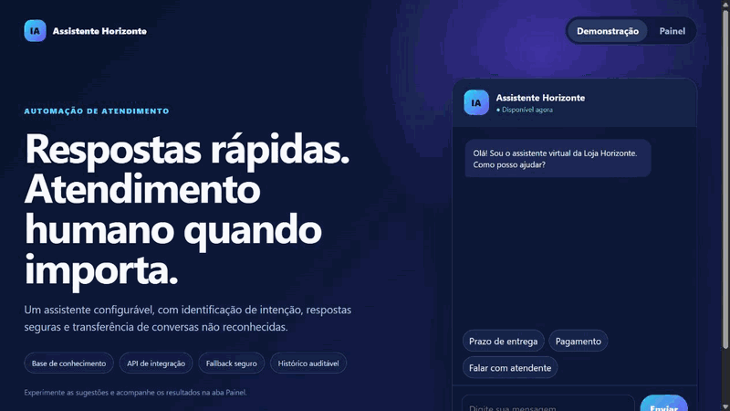
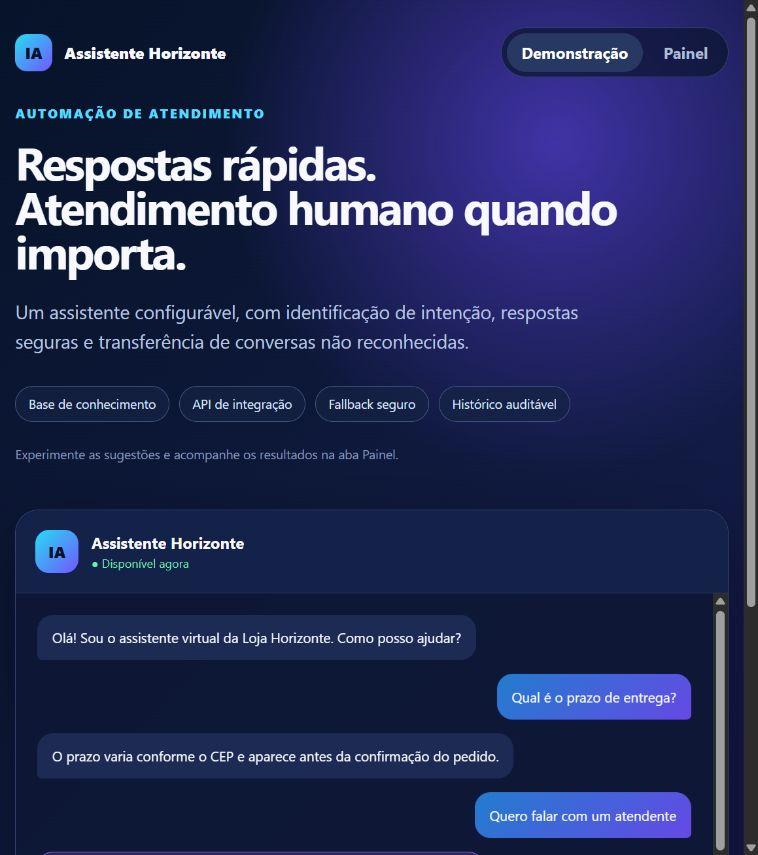
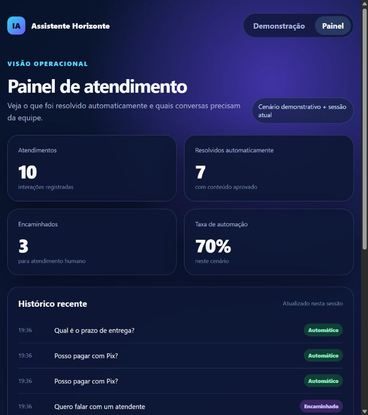

# Assistente virtual para atendimento

MVP de atendimento automatizado que responde dúvidas frequentes, identifica quando não possui informação suficiente e transfere a conversa para uma pessoa da equipe.

O exemplo usa uma loja fictícia e não contém dados, credenciais ou integrações de clientes reais.



## Fluxo da solução



## Demonstração visual







O cliente conversa com o assistente, que consulta a base de conhecimento antes de responder. Quando a solicitação exige análise ou não possui resposta segura, o fluxo encaminha o histórico para atendimento humano. Os registros também permitem acompanhar dúvidas recorrentes e oportunidades de melhoria.

## Problema

Equipes de atendimento perdem tempo respondendo repetidamente dúvidas sobre entrega, rastreio, trocas, pagamentos e horários. Uma automação mal configurada, porém, pode inventar respostas e prejudicar o cliente.

## Solução demonstrada

- base de conhecimento configurável em JSON;
- classificação de intenção tolerante a acentos e pequenas variações;
- respostas estruturadas com intenção e grau de confiança;
- fallback seguro e encaminhamento para atendimento humano;
- pedido explícito de atendente respeitado imediatamente;
- histórico opcional em JSONL para auditoria;
- painel demonstrativo com métricas, histórico e encaminhamentos;
- API HTTP pronta para conexão com site, CRM ou canal de mensagens;
- testes automatizados dos principais fluxos.

Este MVP usa classificação determinística para funcionar sem credenciais pagas. Em um projeto real, o mesmo fluxo pode receber um modelo de IA, busca semântica, webhook do WhatsApp e integração com CRM, mantendo o fallback humano como proteção.

## Executar a demonstração

É necessário Python 3.10 ou superior. Nenhuma biblioteca externa é exigida.

Para conhecer a interface, abra `painel.html` no navegador. Ela simula os principais fluxos, atualiza métricas da sessão e não envia nenhum dado para a internet. A versão original permanece disponível em `demonstracao.html`.

```powershell
python chatbot.py "Qual é o prazo da entrega?"
```

Para salvar o histórico:

```powershell
python chatbot.py "Posso pagar com Pix?" --cliente cliente-demo --historico historico.jsonl
```

## Executar como API

```powershell
python servidor.py
```

Rotas disponíveis:

- `GET /health`: informa se o serviço está ativo;
- `POST /mensagens`: recebe `{"mensagem": "Quais formas de pagamento?"}`.

Exemplo de resposta:

```json
{
  "mensagem": "Aceitamos Pix e cartão de crédito. As condições de parcelamento são exibidas no fechamento da compra.",
  "intencao": "formas_pagamento",
  "confianca": 0.6,
  "encaminhar_humano": false
}
```

## Testes

```powershell
python -m unittest discover -s tests -v
```

## Possíveis evoluções para um cliente real

- integração oficial com WhatsApp Business;
- conexão com OpenAI ou outro provedor de IA;
- respostas baseadas em documentos da empresa;
- painel de conversas e métricas;
- autenticação, limites de uso e proteção de dados;
- transferência automática para o setor correto;
- implantação em nuvem e monitoramento.

## Limites da demonstração

O projeto não envia mensagens reais e não utiliza um modelo generativo. A conexão com canais externos, regras comerciais e tratamento de dados pessoais deve ser definida conforme cada operação.
